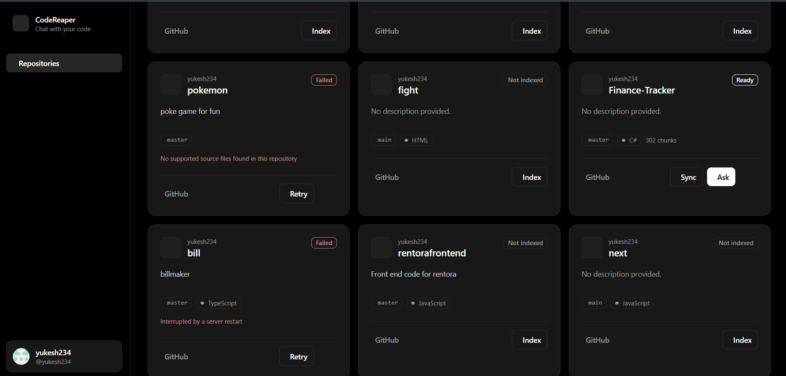
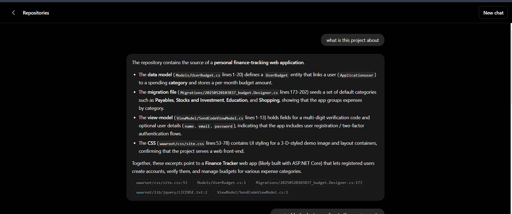

# CodeReaper Frontend

Live app: https://code-reaper-fe.vercel.app/

CodeReaper is a developer-focused repository Q&A application that helps you understand a codebase without manually reading through dozens of files. It connects to GitHub, lets you choose which repositories to index, and then answers natural-language questions using the actual source code in that repo.

## Overview

This frontend is the interface for the CodeReaper platform. It gives users a clean onboarding flow, a repository dashboard, and a chat experience for asking questions such as:

- How is this project structured?
- Where is authentication handled?
- How does a specific feature work?
- How do I run this locally?

Each answer is grounded in repository content and includes links back to the relevant files so you can verify the response quickly.

## Key features

- GitHub sign-in and session-based authentication
- Repository dashboard with visibility and indexing status filters
- Index, sync, retry, and remove repository data
- Natural-language chat for exploring a selected repository
- Source-backed answers with file references and links
- Streaming responses for a more conversational experience
- Responsive UI designed for desktop and smaller screens

## Tech stack

- React 19
- Vite
- React Router
- Tailwind CSS
- Framer Motion
- Lucide React
- Fetch-based API client with cookie-based auth sessions

## Project structure

- `src/App.jsx` — application routes and protected route handling
- `src/pages/Landing.jsx` — marketing / onboarding page and GitHub login entry
- `src/pages/Dashboard.jsx` — repository management and indexing status UI
- `src/pages/RepoChat.jsx` — repository Q&A chat interface
- `src/Auth/` — auth context and route guard logic
- `src/api.js` — shared API helper for backend requests
- `src/index.css` / `src/landing.css` — styling and layout

## Local setup

1. Install dependencies:

   npm install

2. Create or update your environment file:

   VITE_API_URL=https://codereaperbe-production.up.railway.app

   You can also point it to your local backend if you are running CodeReaper's API server separately.

3. Start the app in development mode:

   npm run dev

4. Open the local Vite URL in the browser, typically:

   http://localhost:5173

## Available scripts

- `npm run dev` — start the development server
- `npm run build` — create a production build
- `npm run preview` — preview the production build locally
- `npm run lint` — run ESLint checks

## Environment variables

The app expects the following front-end variable:

- `VITE_API_URL` — base URL for the CodeReaper backend API

## Deployment

This frontend is deployed to Vercel and is live at:

https://code-reaper-fe.vercel.app/

It communicates with the backend service that handles GitHub OAuth, repository indexing, and repository chat logic.

## Typical user flow

1. Sign in with GitHub.
2. Choose a repository from the dashboard.
3. Index the repo so CodeReaper can understand and search its code.
4. Ask questions in plain English and receive answers supported by source references.

## Notes

This project is intended as the frontend layer of a repository-aware AI coding assistant. It is optimized for a fast and lightweight experience while keeping answers grounded in the actual codebase instead of generic AI responses.

## demo Screenshots

